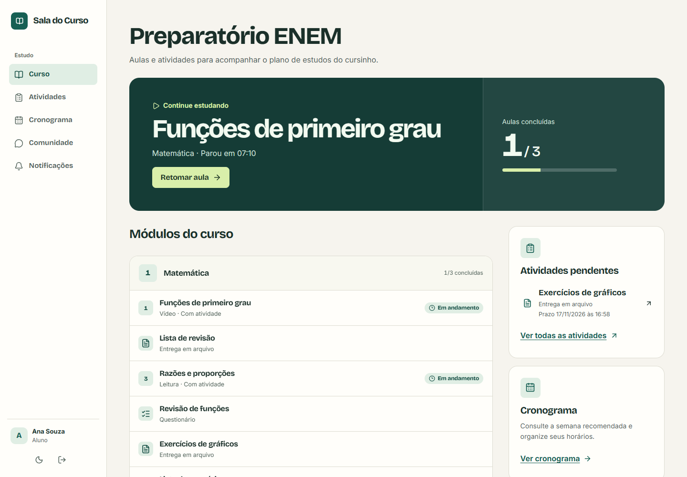
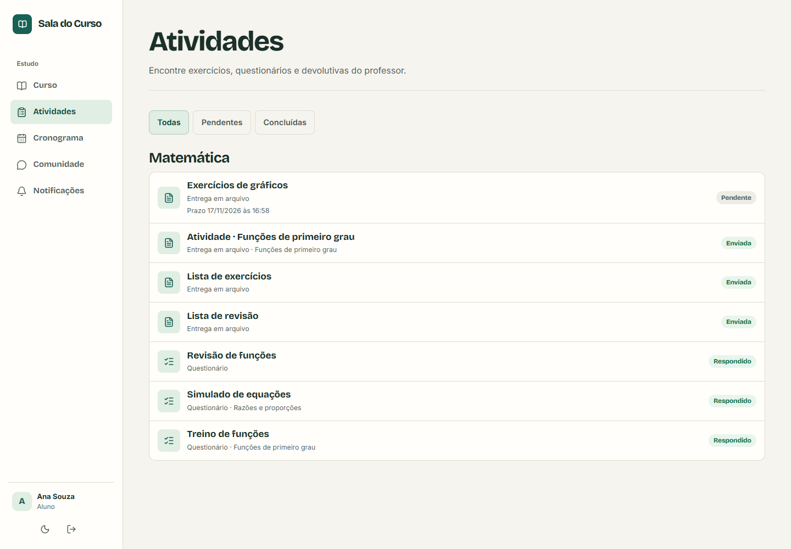
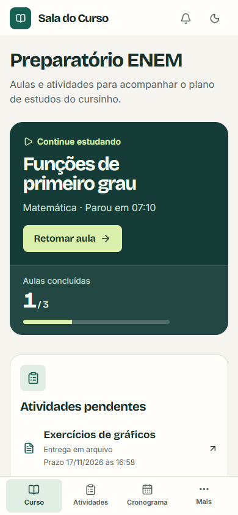
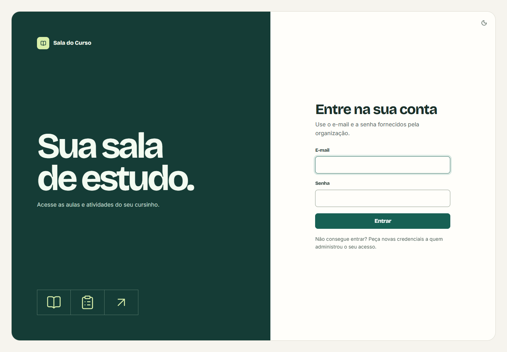
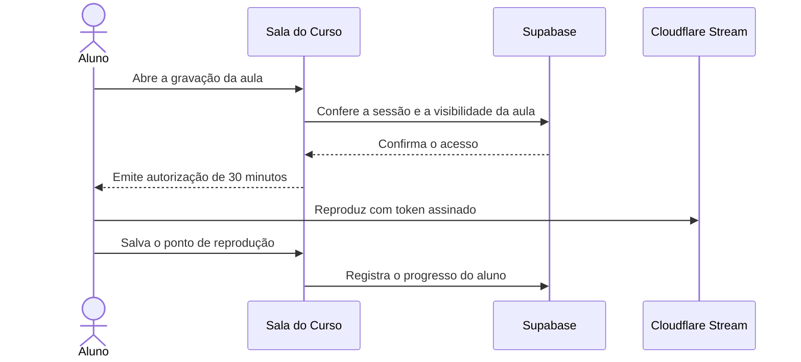

<h1 align="center">Sala do Curso</h1>

<p align="center">
  <strong>Uma sala de aula digital para cursinhos.</strong><br>
  Aulas gravadas, exercícios e correções em um curso organizado por módulos.
</p>

<p align="center">
  <a href="#como-funciona">Como funciona</a> ·
  <a href="#rodar-localmente">Rodar localmente</a> ·
  <a href="#vídeo-privado">Vídeo privado</a> ·
  <a href="docs/DEPLOY.md">Guia de publicação</a>
</p>



*Capturas do app com dados de demonstração.*

## Como funciona

Cada instalação atende **um cursinho e um curso**. A equipe organiza o conteúdo em módulos. A turma encontra a próxima aula, as atividades e o cronograma na mesma conta.

| Papel | O que pode fazer |
| --- | --- |
| **Aluno** | Retomar gravações no ponto salvo, acompanhar o progresso, consultar materiais, responder a questionários e receber feedback privado. |
| **Professor** | Organizar módulos, salvar rascunhos, agendar publicações, enviar gravações privadas e acompanhar entregas e respostas. |
| **Administrador** | Criar contas e exercer as permissões de professor. |

O professor pode publicar uma **atividade avulsa** no módulo ou **vinculá-la a uma aula**. Entregas aceitam PDF ou imagem e têm uma conversa privada para correções. Questionários são corrigidos no servidor e permitem configurar novas tentativas e exibição do gabarito. A turma também tem comunidade de dúvidas e um cronograma semanal que cada aluno pode adaptar.

<table>
  <tr>
    <th>Atividades</th>
    <th>Celular</th>
  </tr>
  <tr>
    <td></td>
    <td></td>
  </tr>
</table>

<details>
  <summary>Ver a tela de entrada</summary>

  
</details>

## Rodar localmente

Use **Node.js 22+**, npm e Docker para executar o Supabase local. Para conectar a um projeto Supabase hospedado, siga o [guia de publicação](docs/DEPLOY.md#preparar-o-supabase).

**1. Instale as dependências e inicie o banco local**

```bash
git clone https://github.com/RafaelADSdev/Plataforma-Video.git
cd Plataforma-Video
npm ci
npx supabase start
npx supabase status
```

O primeiro início aplica as migrações em `supabase/migrations`. Se a instância local já existir, use `npx supabase migration up --local` para aplicar as pendentes. [Supabase CLI](https://supabase.com/docs/guides/local-development/cli/getting-started)

**2. Configure o ambiente**

Copie [`.env.example`](.env.example) para `.env.local`. Use `cp .env.example .env.local` no macOS ou Linux e `Copy-Item .env.example .env.local` no PowerShell.

| Variável | Valor no desenvolvimento local |
| --- | --- |
| `NEXT_PUBLIC_SUPABASE_URL` | URL HTTP da API local exibida pelo Supabase. |
| `NEXT_PUBLIC_SUPABASE_PUBLISHABLE_KEY` | Chave publishable da instância local. |
| `SUPABASE_URL` | A mesma URL da API para as operações no servidor. |
| `SUPABASE_SECRET_KEY` | Chave secret da instância local, usada pelo servidor e pelo bootstrap. |

Aulas em texto e atividades funcionam com o Supabase. Para enviar gravações, configure também o [Cloudflare Stream](docs/DEPLOY.md#configurar-o-cloudflare-stream). Guarde as chaves de servidor em `.env.local` ou nas variáveis protegidas do ambiente.

**3. Crie a primeira conta e abra o app**

```bash
node --env-file=.env.local scripts/create-first-admin.mjs
npm run dev
```

Entre em [localhost:3000/login](http://localhost:3000/login) com a conta criada pelo script. Em **Contas**, cadastre um professor e um aluno para experimentar os dois fluxos. O cadastro é administrado pela escola.

## Vídeo privado

O professor salva a aula como rascunho e envia o arquivo ao Cloudflare Stream pela edição. O envio pode ser retomado após uma interrupção. A publicação de uma nova gravação fica disponível quando o processamento termina.



A gravação exige token assinado e reprodução em um domínio autorizado. A sessão é revalidada a cada renovação. No banco, as políticas de acesso por linha (RLS) protegem as entregas e o progresso. O gabarito fica no schema privado e segue a configuração de revisão do professor. [Segurança do projeto](docs/SECURITY.md) · [Reprodução assinada no Stream](https://developers.cloudflare.com/stream/viewing-videos/securing-your-stream/)

## Projeto

| Camada | Tecnologia |
| --- | --- |
| Aplicação | Next.js 16 com App Router, React 19 e TypeScript |
| Contas, dados e arquivos | Supabase Auth, Postgres com RLS e Storage privado |
| Vídeo | Cloudflare Stream com upload TUS e URLs assinadas |
| Verificação | ESLint, TypeScript e Vitest |

```text
src/app/              Páginas, ações de servidor e rotas de API
src/components/       Navegação, formulários, player e atividades
src/lib/              Autenticação, validação e integração com os serviços
supabase/migrations/  Esquema, permissões, buckets e migrações de dados
```

Execute `npm run check` para rodar lint, checagem de tipos, testes e build. Para alterar a interface, consulte a [identidade visual](DESIGN.md). Para preparar uma instalação, migrar gravações ou verificar as permissões, use o [guia de publicação](docs/DEPLOY.md).
